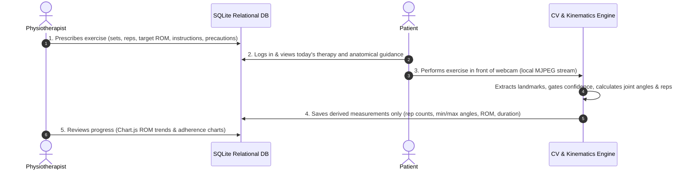

# AI-Assisted Physiotherapy Platform: Hand & Wrist Rehabilitation

> **Clinical & Legal Notice:** Camera-based estimate, not a clinical measurement. The AI never diagnoses, prescribes, changes a prescription, or claims to treat or cure. All clinical decisions remain strictly with the licensed physiotherapist.

An end-to-end computer-vision and clinical telemetry platform designed for hand and wrist physical therapy rehabilitation.

---

## 1. Clinical Workflow

The platform bridges remote rehabilitation and clinical oversight across a 4-step loop:



---

## 2. Technical Architecture & Local Demo Limitation

- **Computer Vision:** Pretrained Google MediaPipe Tasks `HandLandmarker` (21 3D joint landmarks).
- **Kinematics:** Deterministic, explainable vector dot products (`calculate_angle`), moving average filters, and hysteresis dual-threshold state machines.
- **Backend & Database:** Flask with session-based authentication, role-based access control, and SQLite relational database with foreign keys.
- **Frontend:** Responsive HTML5, Vanilla CSS dark healthcare theme, interactive SVG anatomical hand diagrams, and Chart.js telemetry charts.
- **Local Demo MJPEG Limitation Note:** The Flask backend reads the local webcam with OpenCV (`cv2.VideoCapture(0, cv2.CAP_DSHOW)`) and streams annotated frames to the page via multipart MJPEG (`/api/video_feed/<id>`). This is designed as a local laptop university demonstration. In production multi-device cloud deployments, browser-native WebRTC peer-to-peer streaming would be used instead.

---

## 3. The 3 Prescribed MVP Hand Exercises

1. **Fist Open / Close (Finger Flexion):**
   - Measures joint angles across Proximal Interphalangeal (PIP) joints of index, middle, ring, and pinky fingers.
   - Evaluated as repetition cycles ($140^\circ \to 95^\circ \to 140^\circ$).
2. **Thumb-to-Fingertip Touch (Opposition):**
   - Measures Euclidean distance between thumb tip and index fingertip.
   - **Normalized by hand size:** Divided by the anatomical distance from Wrist (0) to Middle Knuckle (9) so measurements remain invariant regardless of how close or far the patient sits from the camera.
3. **Wrist Flexion / Extension (Approximate Hand Tilt):**
   - Approximates hand longitudinal axis tilt relative to the camera frame.
   - **Mandatory Limitation Notice:** Stamped with a visible notice explaining that the MediaPipe hand model tracks hand landmarks only and lacks forearm tracking.

---

## 4. Quick Start & Setup (Windows)

### 4.1. Prerequisites
- Windows 10/11
- Python 3.11+
- Built-in or external USB webcam (Index 0)

### 4.2. Environment Setup
Open PowerShell in the project directory:

```powershell
# 1. Activate the virtual environment
.\venv\Scripts\Activate.ps1

# 2. Set PYTHONPATH to the project directory
$env:PYTHONPATH="hand_physio_ai"

# 3. Verify all 59 automated tests pass
python -m pytest hand_physio_ai\tests -v
```

### 4.3. Launch the Application
Run the master entry-point:
```powershell
python hand_physio_ai\run.py
```
Open your browser at: **`http://127.0.0.1:5000`**

---

## 5. Pre-Seeded University Demo Accounts

The database comes pre-seeded with accounts for examination demonstration:

| Portal | Username | Password | Full Name & Role |
| :--- | :--- | :--- | :--- |
| **Clinician Portal** | `dr_sarah` | `physio123` | Dr. Sarah Jenkins, PT (Attending Physiotherapist) |
| **Patient Portal** | `john_doe` | `patient123` | John Doe (Distal fracture rehabilitation patient) |

*You can also click the 1-click login buttons on the login screen for instant demonstration.*

---

## 6. Directory Structure

```text
hand_physio_ai/
    src/
        pose/           # CameraManager (DirectShow), HandDetector (MediaPipe Tasks), draw_skeleton
        features/       # Vector angles, depth-normalization, moving average smoothing
        analysis/       # RepCounter state machine, 3 exercise definitions, session ROM
        feedback/       # Clinical feedback and safety notices
    backend/            # Flask server, session auth, RBAC guards, REST endpoints, MJPEG streamer
    database/           # schema.sql, db.py, seed.py, hand_physio.db
    frontend/
        static/css/     # Modern medical dark-theme stylesheet
        templates/      # base.html, login.html, patient/dashboard.html, patient/workout.html, clinician/dashboard.html
    models/             # Pretrained Google MediaPipe hand_landmarker.task model
    tests/              # 59 automated pytest suites (camera, detector, angles, rep counter, exercises, db, backend, views, safety)
    docs/               # architecture.md, limitations.md, privacy.md, demo_script.md
    requirements.txt    # Locked dependency manifest
    README.md           # Master project documentation
    run.py              # Master application runner
```

---

## 7. Hard Safety & Privacy Compliance Rules

1. **AI Never Diagnoses:** The AI provides exercise biofeedback only. The physiotherapist makes all clinical decisions.
2. **No Invented Numbers:** All data originates from real empirical measurements.
3. **Clinical Disclaimer:** Every screen shows: *"Camera-based estimate, not a clinical measurement."*
4. **Rule-Based Math:** Kinematics rely on deterministic dot-product trigonometry and hysteresis state machines.
5. **Tracking Reliability Gate:** If tracking drops, the system displays: *"Movement could not be measured reliably. Adjust camera position or lighting."* and never counts phantom repetitions.
6. **Strict Privacy:** **Zero raw video or images are stored**. Derived numerical telemetry only.
7. **No Fabricated Scores:** Prohibits arbitrary "recovery percentages" or proprietary scores.
