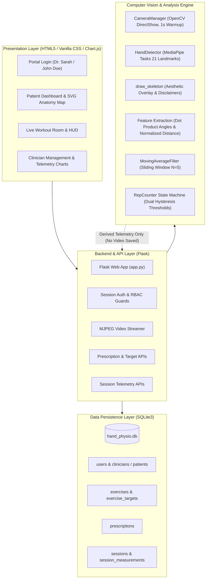
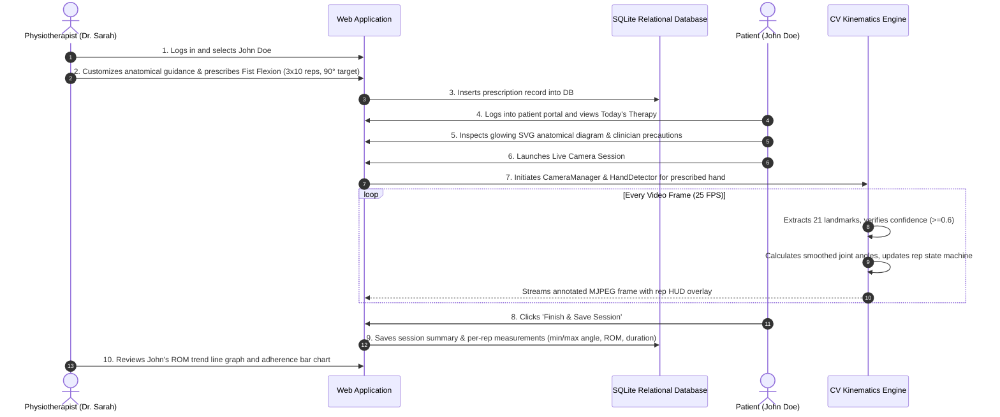

# System Architecture: AI-Assisted Physiotherapy Platform

> **Clinical Notice:** Camera-based estimate, not a clinical measurement. The AI never diagnoses, prescribes, or claims to treat or cure. All clinical decisions remain strictly with the physiotherapist.

---

## 1. High-Level System Architecture

The platform architecture follows a modular, layered structure connecting hardware camera access, MediaPipe pose estimation, rule-based mathematical analysis, SQLite relational persistence, and Flask web interfaces:

---

## 2. End-to-End Clinical Flow

---

## 3. Core Mathematical Models (Strictly Rule-Based)

### 3.1. Vector Angle Formula
For joint vertex $B$ with adjacent landmarks $A$ and $C$:
$$\vec{u} = A - B, \quad \vec{v} = C - B$$
$$\cos(\theta) = \frac{\vec{u} \cdot \vec{v}}{\|\vec{u}\| \|\vec{v}\|}$$
$$\theta = \arccos\left(\operatorname{clip}\left(\cos(\theta), -1.0, 1.0\right)\right) \times \frac{180^\circ}{\pi}$$

### 3.2. Camera-Distance Invariant Normalization
For thumb-to-fingertip opposition:
$$d_{\text{norm}} = \frac{\|\text{Thumb Tip [4]} - \text{Index Tip [8]}\|}{\|\text{Wrist [0]} - \text{Middle MCP [9]}\|}$$
This normalizes physical camera depth, making measurements independent of whether the patient sits close or far from the laptop.

### 3.3. Hysteresis State Machine
- **Flexion Phase:** Angle drops below active threshold ($\theta \le 95^\circ$).
- **Extension Phase:** Angle returns above rest threshold ($\theta \ge 140^\circ$).
- **Time Gate:** Requires duration $\ge 0.4\text{s}$ to reject tremors or camera blips.
